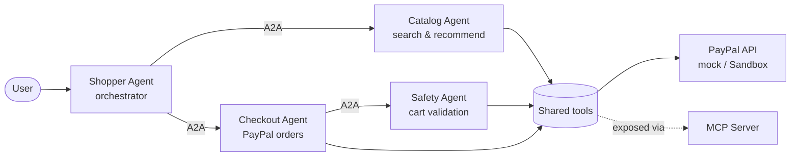

# 🛍️ Clothing Transaction Agent

An agentic AI shopping assistant where multiple specialized agents cooperate to search products, personalize recommendations, enforce transaction safety, and complete checkout through PayPal.

Built around **Google ADK**, **MCP (Model Context Protocol)**, and **A2A-style agent-to-agent messaging**.

> **Status:** working prototype. Runs out of the box with mock data and a mock PayPal; optional modes connect to Google ADK, an MCP server, and the PayPal Sandbox. All catalog and customer data is fake.

---

## Features

- **Multi-agent coordination:** an orchestrator delegates to catalog, safety, and checkout agents
- **Natural-language shopping:** "show me black hoodies under $60", "find sneakers size 10"
- **Personalized recommendations** from saved category, color, and budget preferences
- **Transaction safety layer** that validates every cart before money moves
- **Secure checkout flow** via the PayPal Orders API (mock by default, Sandbox when keys are set)
- **One set of tools, three interfaces:** the same functions power the built-in agents, Google ADK agents, and an MCP server
- **Zero-setup demo mode:** standard library only, no API keys required

---

## Quick Start

Requires **Python 3.9+**.

```bash
git clone https://github.com/<your-username>/<repo-name>.git
cd <repo-name>

python main.py --demo    # scripted walkthrough
python main.py           # interactive chat (type "help")
```

**In VS Code:** open the folder, open `main.py`, and press the ▶ Run button. Two launch configurations ("Chat with the agent" and "Scripted demo") are included under Run and Debug.

Add `--quiet` to hide the agent-to-agent message trace.

### Example session

```
you> show me black hoodies under $60
  [A2A 789f42f5] shopper_agent -> catalog_agent: search
  [A2A 789f42f5] catalog_agent -> shopper_agent: success
Results:
  P001  Classic Pullover Hoodie    black  $ 54.00

you> add P001 size M
Added 1 x Classic Pullover Hoodie (M).

you> checkout
  [A2A 9dfe0c96] shopper_agent -> checkout_agent: checkout
  [A2A 5c330591] checkout_agent -> safety_agent: validate_cart
  [A2A 5c330591] safety_agent -> checkout_agent: success
Order MOCK-535F5145CB created (MOCK), total $64.45.
  Approve it here: https://www.sandbox.paypal.com/checkoutnow?token=MOCK-535F5145CB
  Then type 'pay' to capture the payment.

you> pay
Payment complete! Paid $64.45. Thanks for shopping.
```

---

## Architecture



| Agent | Responsibility |
|---|---|
| `shopper_agent` | Interprets the user's request and delegates to specialists |
| `catalog_agent` | Product search, filtering (category, color, size, price), recommendations |
| `safety_agent` | Validates carts and returns `approved`, `needs_confirmation`, or `blocked` |
| `checkout_agent` | Requests a safety check over A2A, then creates and captures the PayPal order |

### Transaction safety rules

| Rule | Outcome |
|---|---|
| Cart is empty | Blocked |
| Item or size out of stock | Blocked |
| Quantity of one item > 5 | Blocked |
| Order total > $1,000 | Blocked |
| Order total > $200 | Requires explicit `checkout confirm` |
| Everything else | Approved |

Safety is checked twice: once by the safety agent over A2A, and again inside `create_checkout` itself (defense in depth).

---

## Project Structure

```
.
├── main.py                      # CLI entry point
├── requirements.txt             # optional dependencies (demo needs none)
├── .env.example                 # optional API keys
├── clothing_agent/
│   ├── agents.py                # built-in multi-agent system
│   ├── a2a.py                   # agent cards + message bus (A2A-style)
│   ├── agent.py                 # Google ADK agents (root_agent + sub_agents)
│   ├── mcp_server.py            # tools exposed as an MCP server
│   ├── tools.py                 # shared tools: search, cart, safety, checkout
│   ├── paypal_client.py         # PayPal client (mock or Sandbox)
│   └── catalog.py               # fake product catalog
└── tests/
    └── test_flow.py             # unit + end-to-end conversation tests
```

---

## Optional Modes

### Google ADK (LLM-driven agents)

```bash
pip install google-adk
export GOOGLE_API_KEY=your_key      # get one at aistudio.google.com
adk web                             # run from the project root, select "clothing_agent"
```

The ADK version uses the same tools, with `sub_agents` delegation in place of the built-in A2A bus. Change the model with the `ADK_MODEL` environment variable (default `gemini-2.0-flash`).

### MCP server

```bash
pip install mcp
python -m clothing_agent.mcp_server
```

Exposes all shopping tools over stdio so any MCP client can use them.

### PayPal Sandbox

1. Create a sandbox app at [developer.paypal.com](https://developer.paypal.com).
2. Copy `.env.example` to `.env` and fill in `PAYPAL_CLIENT_ID` and `PAYPAL_CLIENT_SECRET` (or export them in your shell).
3. Run the app. Orders are now created against the Sandbox API; no real money moves.

With a live Sandbox order, open the approval link and approve it as a sandbox buyer before typing `pay`.

---

## Testing

```bash
python -m unittest discover -s tests
```

Covers search filters, out-of-stock handling, each safety rule, the confirmation threshold, and a full chat → checkout → payment flow.

---

## Limitations and Roadmap

- The A2A layer is a lightweight in-process implementation of the protocol's ideas (agent cards, tasks, messages), not the full HTTP-based A2A specification.
- Cart and order state lives in memory and resets on restart.
- The built-in demo agent uses rule-based intent parsing; the ADK mode provides LLM-driven understanding.
- Ideas: persistent storage, real A2A over HTTP, a web UI, multi-user sessions, order history.

---

## License

MIT (add a `LICENSE` file before publishing if you want this to apply).
